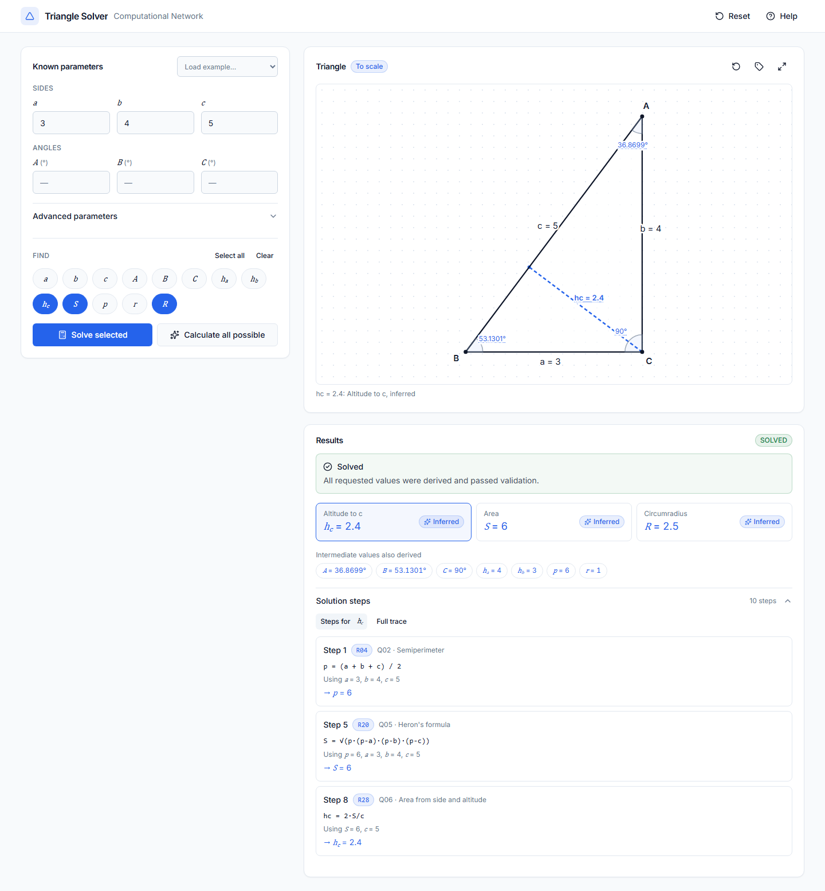
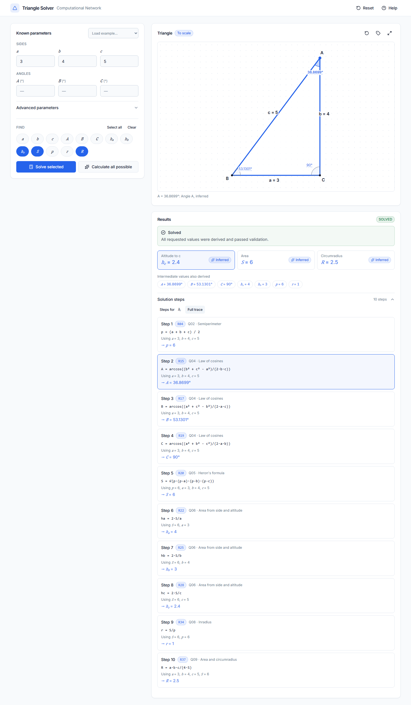
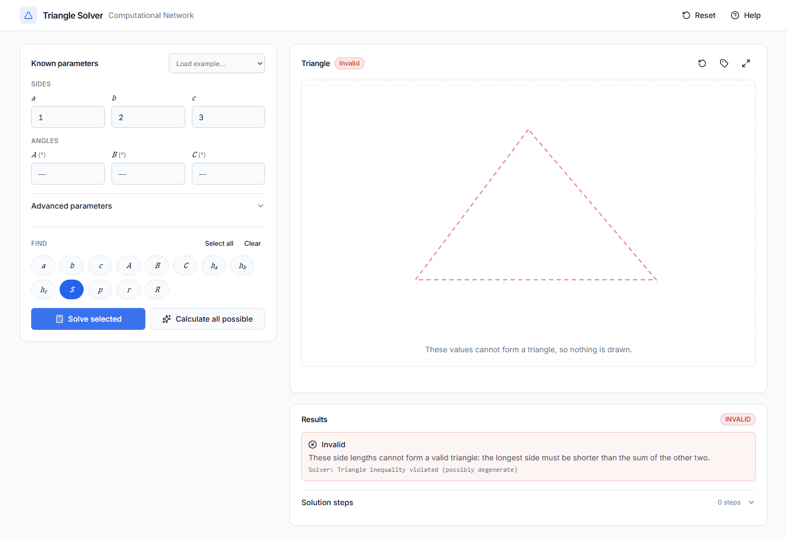
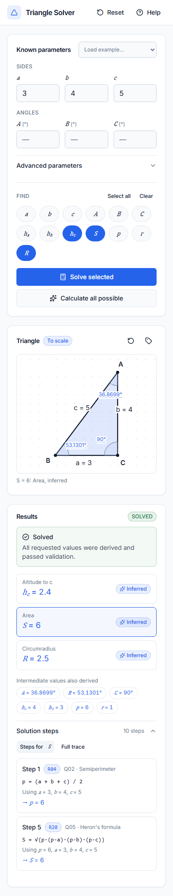

# Triangle Knowledge Base — Bài 1

Hệ cơ sở tri thức tam giác bằng mạng tính toán **(M, F)**: đúng **13 biến, 10 nhóm Q01–Q10, 46 luật R01–R46** theo Phụ lục A của [báo cáo](Bao_cao_Bai_1.pdf). Suy diễn tiến tổng quát, kiểm tra dữ kiện và dấu vết giải thích. CLI và FastAPI cùng gọi `SolverService`.

## Tính năng

- Nhập dữ kiện tam giác (6 tham số cơ bản và 7 tham số nâng cao), chọn mục tiêu hoặc "Calculate all possible".
- Suy diễn tiến bằng 46 luật; validator phát hiện INVALID/INCONSISTENT.
- Hình tam giác SVG vẽ đúng tỉ lệ từ các cạnh do backend suy ra. Có highlight cạnh, góc, đường cao, diện tích, đường tròn nội/ngoại tiếp.
- Giải thích kết quả bằng đúng trace của backend, có lọc theo chuỗi phụ thuộc của từng kết quả.
- FastAPI REST API và CLI dùng chung `SolverService`.
- Giao diện web responsive (desktop, tablet, mobile), hỗ trợ bàn phím.

## Công nghệ

| Phần | Công nghệ |
|---|---|
| Backend | Python 3.11+, Pydantic v2, FastAPI, Uvicorn; Pytest, HTTPX |
| Frontend | React 19, TypeScript, Vite, Tailwind CSS v4, shadcn/ui (Radix), Lucide; SVG thuần |
| Kiểm thử frontend | Vitest, React Testing Library, Playwright |

## Cài đặt

Cần **Python 3.11+** và **Node.js 20+** (đã kiểm thử với Node 24.11, npm 11.6). Chạy từ thư mục `Bai1`:

```powershell
python -m venv .venv
.\.venv\Scripts\python.exe -m pip install -r requirements.txt
```

Trên Linux/macOS, thay `.\.venv\Scripts\python.exe` bằng `.venv/bin/python`. Nếu `python` trên Windows trỏ vào Microsoft Store, dùng đường dẫn Python đã cài. Môi trường bàn giao được tạo bằng `D:\Anaconda\python.exe` (Python 3.13.5).

Frontend:

```powershell
cd frontend
npm install
npx playwright install chromium   # chỉ cần cho kiểm thử E2E
```

`requirements.txt` chứa khoảng phiên bản; `requirements-lock.txt` ghi môi trường đã kiểm thử (Python 3.13/Windows). Có thể dùng `pip install -r requirements-lock.txt` để tái lập. Thư viện chính: Pydantic v2, FastAPI, Uvicorn; kiểm thử: Pytest và HTTPX. Không cần database.

## CLI

```powershell
.\.venv\Scripts\python.exe main.py --facts "a=3,b=4,c=5" --goals "p,S,hc,r,R"
.\.venv\Scripts\python.exe -m triangle_knowledge_base --facts "a=3,b=4,p=6" --goals "c,S,hc"
.\.venv\Scripts\python.exe main.py --facts "a=3" --goals "S"
.\.venv\Scripts\python.exe main.py --facts "a=3,b=4,c=5,S=7" --goals "S"
.\.venv\Scripts\python.exe main.py --facts "S=6,p=6" --goals "r" --json
```

T01 cho `p=6, S=6, hc=2.4, r=1, R=2.5`. Dữ kiện theo `tên=giá_trị`, ngăn cách dấu phẩy; mục tiêu là danh sách tên biến. CLI in trạng thái, dữ kiện và từng bước suy luận. `--json` giữ toàn bộ độ chính xác. Mã thoát: `0` SOLVED, `1` UNRESOLVED, `2` INVALID/INCONSISTENT hoặc lỗi cú pháp. Không nhập một biến nhiều lần.

## Biến và đơn vị

| Biến | Ý nghĩa | Miền |
|---|---|---|
| `a, b, c` | Cạnh đối diện góc A, B, C | Dương |
| `A, B, C` | Góc trong, đơn vị **độ** | (0, 180) |
| `ha, hb, hc` | Đường cao ứng với từng cạnh | Dương |
| `S` | Diện tích | Dương |
| `p` | Nửa chu vi | Dương |
| `r, R` | Bán kính nội tiếp, ngoại tiếp | Dương |

Tên phân biệt hoa/thường. Độ dài cùng đơn vị; S dùng bình phương đơn vị đó. Request JSON phải chứa số thực/số nguyên hữu hạn; chuỗi giả dạng số, boolean, NaN và infinity bị từ chối. Không cần đủ 13 biến; `goals` có ít nhất một tên hợp lệ và được khử trùng.

## FastAPI

```powershell
.\.venv\Scripts\python.exe -m uvicorn triangle_knowledge_base.app.api.main:app --host 127.0.0.1 --port 8000
```

Mở `http://127.0.0.1:8000/docs` để thử API; schema tại `/openapi.json`.

| Endpoint | Chức năng |
|---|---|
| `POST /api/v1/solve` | Nhận facts/goals, trả SolveResponse |
| `GET /api/v1/variables` | 13 biến, mô tả, miền và đơn vị |
| `GET /api/v1/rules` | Metadata 46 luật theo thứ tự ID |
| `GET /api/v1/rules/R28` | Một luật; ID không tồn tại trả 404 |

Ví dụ PowerShell:

```powershell
Invoke-RestMethod -Method Post -Uri http://127.0.0.1:8000/api/v1/solve -ContentType application/json -Body '{"facts":{"S":6,"p":6},"goals":["r"]}'
```

Response:

```json
{
  "status": "SOLVED",
  "facts": {"S": 6.0, "p": 6.0, "r": 1.0},
  "missing": [],
  "trace": [{
    "step": 1, "rule_id": "R34", "group": "Q08",
    "inputs": {"S": 6.0, "p": 6.0},
    "output": "r", "value": 1.0, "formula": "r = S/p"
  }],
  "message": "All goals derived and facts passed validation"
}
```

**HTTP 422** biểu thị lỗi cấu trúc request (tên lạ, kiểu sai, không có mục tiêu...). Request đúng cấu trúc trả **HTTP 200** với một trong bốn trạng thái nghiệp vụ:

| Trạng thái | Ý nghĩa |
|---|---|
| SOLVED | Đã biết đủ mục tiêu và vượt qua các kiểm tra hiện có |
| UNRESOLVED | Chưa suy ra được từ 46 luật; có thể kèm hạn chế số học |
| INVALID | Giá trị ngoài miền hoặc ba cạnh không tạo tam giác |
| INCONSISTENT | Dữ kiện riêng lẻ hợp lệ nhưng xung đột với quan hệ đã biết |

Ở service/CLI, đầu vào sai cấu trúc trả `INVALID`; API trả 422 trước khi gọi service. Khi lỗi, `facts` chỉ chứa dữ kiện gốc và suy luận đã chấp nhận; ứng viên bị từ chối không xuất hiện trong facts/trace. `missing` là mục tiêu chưa có trong facts, vì vậy có thể rỗng ở T09 dù trạng thái là INCONSISTENT.

## Giao diện web

Mở hai terminal tại `Bai1`:

```powershell
# Terminal 1: backend
.\.venv\Scripts\python.exe -m uvicorn triangle_knowledge_base.app.api.main:app --host 127.0.0.1 --port 8000
# Terminal 2: frontend
cd frontend
npm run dev
```

| URL | Nội dung |
|---|---|
| http://127.0.0.1:5173 | Ứng dụng web (Vite) |
| http://127.0.0.1:8000 | FastAPI backend |
| http://127.0.0.1:8000/docs | Tài liệu API (Swagger) |

Vite proxy chuyển `/api` sang backend, nên không cần cấu hình CORS. Hướng dẫn sử dụng chi tiết: [docs/USER_GUIDE.md](docs/USER_GUIDE.md).

### Biến môi trường

Xem [frontend/.env.example](frontend/.env.example). Không có bí mật nào cần cấu hình.

| Biến | Mặc định | Ý nghĩa |
|---|---|---|
| `VITE_API_BASE_URL` | rỗng | Gốc URL trình duyệt dùng để gọi API; rỗng = cùng origin, đi qua proxy |
| `VITE_BACKEND_URL` | `http://127.0.0.1:8000` | Đích của proxy `/api` (dev/preview) |

### Ảnh chụp màn hình

[Video demo local và ảnh theo từng bước](Demo/README.md) ghi phiên trình duyệt thật: nhập dữ kiện, chọn mục tiêu, xem tam giác, kết quả và chuỗi suy luận. Chạy lại từ `frontend` bằng `npm run demo:record`.

| | |
|---|---|
|  |  |
|  |  |

Các ảnh khác: [desktop-initial](docs/screenshots/desktop-initial.png), [desktop-unresolved](docs/screenshots/desktop-unresolved.png), [tablet-layout](docs/screenshots/tablet-layout.png).

## Kiến trúc và suy luận

```text
CLI (main.py / app.cli) ──┐
                         ├── SolverService ── InferenceEngine ── TriangleValidator
FastAPI (api.routes) ─────┘                         │                     │
                                              RuleRegistry ──────────────┘
                                                   │
                                       Rule metadata + trusted formulas

models: Variable, Rule, SolveRequest, InferenceStep, SolveResponse, SolveStatus
```

Models không chứa hàm thực thi. `knowledge/rules.py` đăng ký callable riêng với metadata; chuỗi công thức chỉ dùng hiển thị, không thực thi bằng `eval`. Core không import CLI/FastAPI. `create_app(service)` cho phép tiêm service; mỗi lần solve dùng facts và trace riêng.

Engine sao chép H, kiểm tra trước khi xét mục tiêu có sẵn, quét R01–R46 và tiếp tục cùng lượt sau mỗi bước. Chỉ chấp nhận biến mới khi trạng thái ứng viên vượt qua validator, rồi ghi trace. Luật đủ đầu vào và đầu ra được đối chiếu. Không ghi đè H, không làm tròn trung gian. Dừng khi đủ G hoặc hết lượt không thêm biến; tối đa `13 − |H|` bước thành công.

Validator kiểm tra miền, bất đẳng thức tam giác, góc, nửa chu vi, Heron kể cả khi H chưa có p, và các quan hệ đủ dữ kiện. `p` phải lớn hơn mỗi cạnh đã biết. So sánh bằng `abs_tol=1e-8, rel_tol=1e-7`. Cosin/Heron dùng dạng đại số tương đương ổn định số học (half-angle, atan2, Kahan), giữ nguyên hướng và đầu vào R14–R20. Không thêm luật arcsin.

## Kiểm thử và bằng chứng

```powershell
.\.venv\Scripts\python.exe -m pytest -v
.\.venv\Scripts\python.exe scripts/record_evidence.py
.\.venv\Scripts\python.exe -m pip check
```

Đã chạy **240 passed, 0 failed** trên Python 3.13.5. Gồm T01–T12; đối chiếu metadata từng luật với [bản chép độc lập phụ lục](triangle_knowledge_base/tests/report_rules.csv); thực thi từng luật trên hai tam giác; validation, số học gần biên, trace; CLI qua subprocess; HTTP schemas, kết quả API và OpenAPI. Có một cảnh báo deprecation từ Starlette TestClient về HTTPX trong môi trường hiện tại; không có lỗi kiểm thử.

Frontend (từ `Bai1/frontend`):

```powershell
npm test                    # unit + component (Vitest, RTL): 41 passed
npm run test:integration    # gọi backend thật; cần uvicorn đang chạy ở :8000: 9 passed
npm run test:e2e            # Playwright, tự khởi động backend và Vite nếu chưa chạy: 13 passed
npm run screenshots         # chụp lại docs/screenshots/
```

Chi tiết: [docs/TEST_REPORT.md](docs/TEST_REPORT.md).

[evidence](evidence/) chứa log Pytest, môi trường/phiên bản, kết quả số và trace T01–T12, bản ghi CLI T01/T04/T09/T11. `record_evidence.py` chạy lại test trước khi xuất kết quả. Xem [báo cáo bàn giao](docs/dev-docs/DELIVERY_REPORT.md) để đối chiếu thay đổi và cập nhật báo cáo học thuật.

## Cấu trúc thư mục

| Thư mục | Vai trò |
|---|---|
| `triangle_knowledge_base/app/` | Backend: models, knowledge (46 luật), core (engine, validator), services, api, cli |
| `triangle_knowledge_base/tests/` | Kiểm thử backend |
| `frontend/src/` | React app: `components/` (giao diện), `lib/` (API client, hình học, kiểm tra đầu vào) |
| `frontend/e2e/` | Kiểm thử Playwright và script chụp màn hình |
| `docs/` | Tài liệu giao diện và ảnh chụp |
| `evidence/`, `scripts/` | Bằng chứng kiểm thử backend |

## Tài liệu

- [UI/UX specification](docs/UI_UX_SPECIFICATION.md)
- [User guide](docs/USER_GUIDE.md)
- [Implementation summary](docs/IMPLEMENTATION_SUMMARY.md)
- [Test report](docs/TEST_REPORT.md)
- [Delivery checklist](docs/DELIVERY.md)

## Giới hạn

Không suy ngược Heron, không giải hệ ký hiệu tổng quát, không phân nhánh SSA/arcsin, không tối ưu số bước. Giao diện chỉ vẽ tam giác sau khi giải, từ các cạnh backend đã suy ra. Trường hợp SSA được đánh dấu "ambiguous" và không vẽ. E2E chỉ chạy trên Chromium. SOLVED chỉ xác nhận các kiểm tra đủ dữ kiện, không chứng nhận đầy đủ tồn tại/duy nhất của toàn bộ tam giác. UNRESOLVED không có nghĩa vô nghiệm toán học.

Số học dùng float hữu hạn. Khi phép tính tràn, hụt số hoặc không biểu diễn được đầu ra hợp lệ, engine bỏ hướng đó và tiếp tục; nếu thiếu mục tiêu, thông báo nêu giới hạn số học. Riêng lỗi thực thi số học không đủ để kết luận toàn bộ bài toán INVALID. Dữ liệu cực đoan vẫn cần chuẩn hóa đơn vị; tolerance tuyệt đối giảm độ nhạy với số rất nhỏ.
