# HƯỚNG DẪN SỬ DỤNG

## 1. Cài đặt và khởi động

**Yêu cầu:** máy đã cài Python 3.10 trở lên.

**Bước 1 – Cài thư viện.** Chạy lệnh ở thư mục gốc của bài 2:

```bash
python -m pip install -r requirements.txt
```

**Bước 2 – Chạy chương trình.** Vẫn ở thư mục đó, chạy:

```bash
python -m streamlit run src/app.py
```

- Trên Windows có thể bấm đúp file `run_app.bat` thay cho lệnh trên.
- Trình duyệt sẽ tự mở trang `localhost` bằng trình duyệt

**Bước 3 – Tắt chương trình.** Nhấn `Ctrl + C` trong cửa sổ Terminal.

---

## 2. Bố cục giao diện

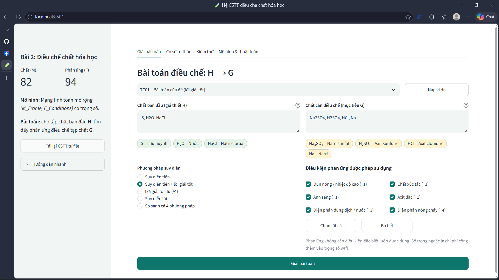

**Thanh bên trái** gồm:

- Số chất và số phản ứng đang có trong cơ sở tri thức (CSTT).
- Mô tả ngắn về mô hình.
- Nút **Tải lại CSTT từ file**.
- Mục **Hướng dẫn nhanh**.

**Bốn tab chính:**

| Tab | Chức năng |
|---|---|
| **Giải bài toán** | Nhập chất ban đầu và chất cần điều chế, chọn phương pháp, xem lời giải |
| **Cơ sở tri thức** | Xem, tìm kiếm, thêm/sửa/xóa chất và phản ứng; kiểm tra tính nhất quán; xem sơ đồ mạng |
| **Kiểm thử** | Chạy toàn bộ 15 test case và xem kết quả |
| **Mô hình & thuật toán** | Tóm tắt mô hình tri thức và các thuật toán đã cài đặt |

---

## 3. Giải bài toán điều chế

### 3.1. Nhập dữ kiện

1. **Chất ban đầu (giả thiết H):** các chất đã có, cách nhau bởi dấu phẩy.
2. **Chất cần điều chế (mục tiêu G):** một hoặc nhiều chất cần điều chế.

Có thể nhập theo nhiều cách. Hệ thống tự so khớp:

| Cách nhập | Ví dụ | Kết quả |
|---|---|---|
| Công thức chính xác | `H2SO4` | H₂SO₄ |
| Sai chữ hoa/thường | `h2so4`, `nacl` | H₂SO₄, NaCl |
| Chỉ số Unicode | `H₂SO₄` | H₂SO₄ |
| Tên tiếng Việt / tiếng Anh | `axit sunfuric`, `sulfuric acid` | H₂SO₄ |
| Tên thông dụng | `muối ăn`, `xút`, `vôi sống`, `thuốc tím` | NaCl, NaOH, CaO, KMnO₄ |
| Ngăn cách bằng dấu cách | `S H2O NaCl` | S, H₂O, NaCl |

Ngay dưới mỗi ô nhập có các nhãn màu cho biết hệ thống đã hiểu dữ kiện thế nào:

- Nhãn **xanh lá**: chất ban đầu nhận dạng được.
- Nhãn **vàng**: chất cần điều chế nhận dạng được.
- Nhãn **đỏ có dấu ✘**: dữ kiện không nhận dạng được.

> **Mẹo:** Chọn một ví dụ trong ô **"Nạp nhanh một ví dụ"** rồi bấm **Nạp ví dụ**. Hệ thống sẽ tự điền dữ kiện, phương pháp và điều kiện của test case đó. Ví dụ mặc định là bài toán của đề: *S, H2O, NaCl → Na2SO4, H2SO4, HCl, Na*.

### 3.2. Chọn phương pháp suy diễn

| Phương pháp | Mô tả |
|---|---|
| **Suy diễn tiến** | Từ các chất đã có, lần lượt áp dụng phản ứng sinh ra chất mới cho đến khi có đủ mục tiêu. Có thể có bước thừa. |
| **Suy diễn tiến + lời giải tốt** | Suy diễn tiến xong thì loại các phản ứng không cần thiết (duyệt từ cuối về đầu). |
| **Lời giải tối ưu (A\*)** | Tìm dãy phản ứng có **tổng trọng số nhỏ nhất** trên mạng suy diễn có trọng số. |
| **Suy diễn lùi** | Đi từ chất cần điều chế, tìm phản ứng tạo ra nó, rồi lần ngược về các chất ban đầu. |
| **So sánh cả 4 phương pháp** | Chạy cả bốn phương pháp và đặt kết quả cạnh nhau. |

### 3.3. Chọn điều kiện phản ứng được phép

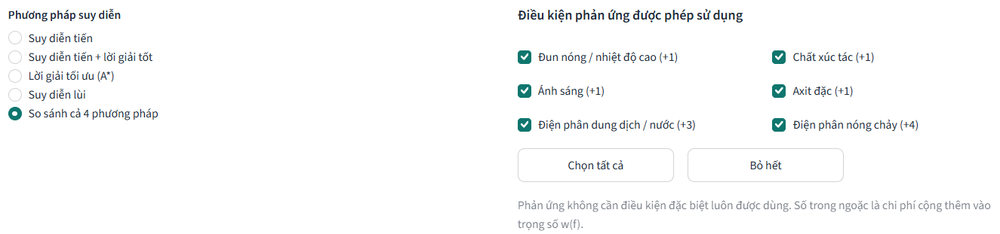

Mỗi phản ứng có thể cần điều kiện đặc biệt: đun nóng, xúc tác, ánh sáng, axit đặc, điện phân dung dịch, điện phân nóng chảy.

- **Mặc định:** bật tất cả điều kiện.
- **Bỏ chọn một điều kiện:** hệ thống sẽ **không dùng** các phản ứng cần điều kiện đó. Nhờ vậy có thể xem hệ thống giải trong các tình huống khác nhau.
- **Nút Chọn tất cả / Bỏ hết:** bật hoặc tắt nhanh mọi điều kiện.
- Phản ứng không cần điều kiện đặc biệt luôn được dùng.
- Số trong ngoặc, ví dụ `(+4)`, là chi phí cộng vào trọng số w(f) của phản ứng. A\* dựa vào trọng số này để chọn lời giải rẻ nhất.

### 3.4. Xem kết quả

Bấm **Giải bài toán**. Kết quả gồm các phần sau.

**a) Kết luận và số liệu tổng quan:**

- Số phản ứng.
- Tổng trọng số w(S).
- Số chất trong bao đóng Closure(H).
- Thời gian giải.

**b) Bảng các bước điều chế.** Mỗi dòng gồm: mã phản ứng, phương trình đã cân bằng, điều kiện, chất cần tính ở bước đó (B'ᵢ), sản phẩm phụ và trọng số.

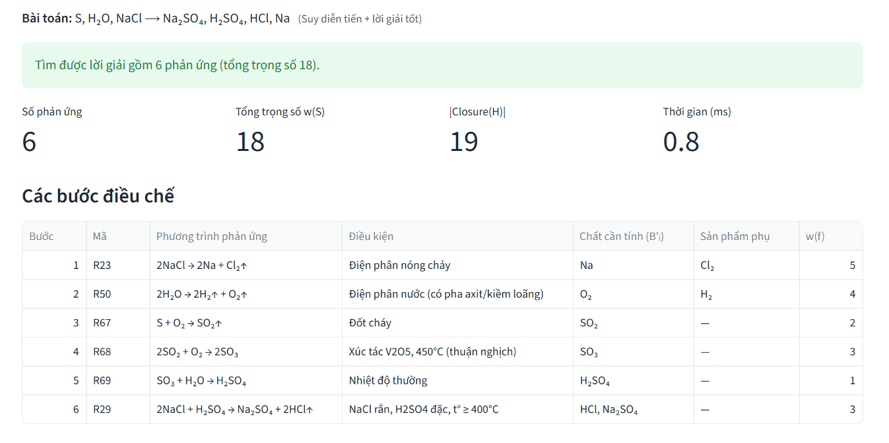

**c) Quá trình giải.** Mỗi bước được diễn đạt theo dạng *"Xác định X – áp dụng phản ứng f"*. Nếu chọn *lời giải tốt*, hệ thống còn cho biết lời giải ban đầu có bao nhiêu phản ứng và đã loại những phản ứng nào.

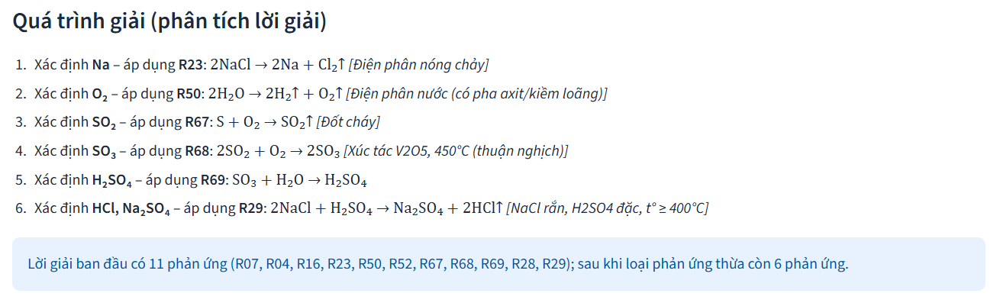

**d) Sơ đồ mạng của lời giải.**

- Nút hình elip là chất; nút hình hộp là phản ứng (ghi số bước và điều kiện).
- Màu **xanh lá**: chất ban đầu. Màu **vàng**: chất cần điều chế. Màu **xanh nhạt**: chất trung gian. Màu **xám, nét đứt**: sản phẩm phụ không dùng tới.

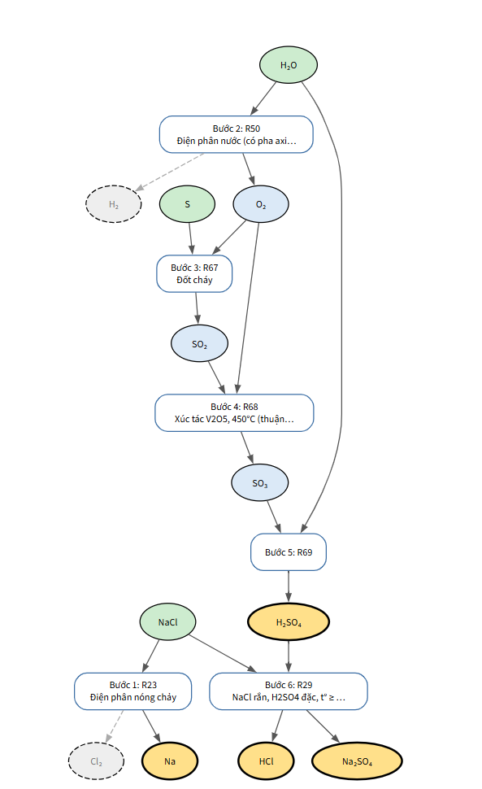

**e) Diễn biến suy luận.** Mở mục **Diễn biến suy luận** để xem từng bước bộ suy diễn đã làm:

- **Suy diễn lùi:** cây mục tiêu – mục tiêu con, các nhánh bị loại do vòng lặp hoặc do không có phản ứng tạo ra.

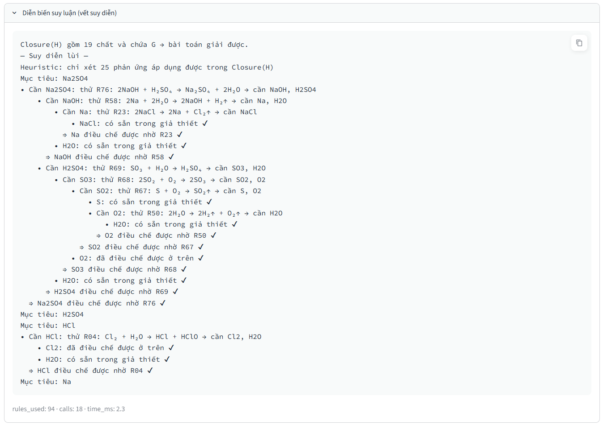

- **A\*:** các đỉnh được xét theo thứ tự, kèm giá trị g và f, cùng tổng trọng số tối ưu.

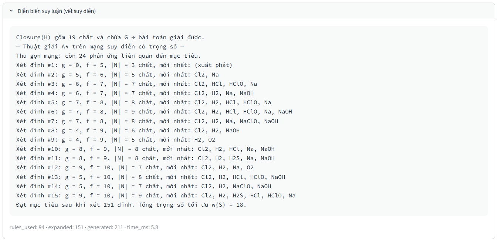

**f) Closure(H).** Mục cuối liệt kê mọi chất suy ra được từ giả thiết.

### 3.5. So sánh các phương pháp

Chọn **So sánh cả 4 phương pháp** rồi bấm **Giải bài toán**. Bảng tổng hợp cho thấy:

- Suy diễn tiến cho 11 phản ứng (trọng số 27).
- Lời giải tốt và A\* cho 6 phản ứng (trọng số 18).
- Suy diễn lùi cho 8 phản ứng (trọng số 18).

Bên dưới bảng có các tab để xem chi tiết từng phương pháp.

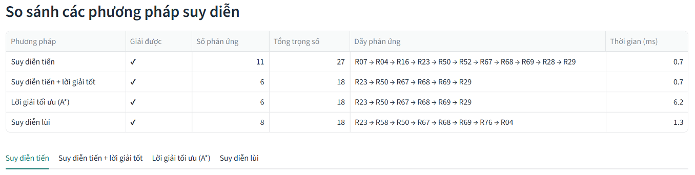

### 3.6. Khi bài toán không giải được – Bổ sung giả thiết

Ví dụ: bỏ chọn **Điện phân nóng chảy** rồi giải lại bài toán của đề. Hệ thống sẽ:

1. Báo **không giải được** và chỉ ra chất không điều chế được (Na).
2. Liệt kê các chất vẫn điều chế được.
3. Đề xuất các tập chất cần **bổ sung vào giả thiết**. Mỗi đề xuất có một nút **➕ Thêm … và giải lại**.

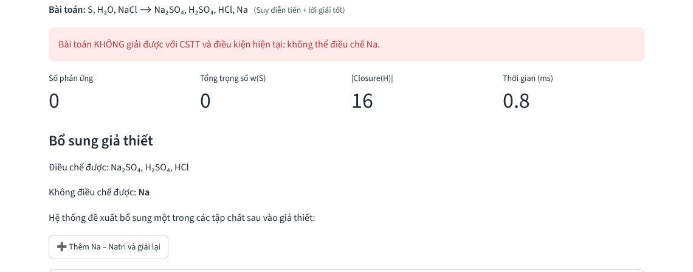

Bấm nút đề xuất: hệ thống tự thêm chất vào ô giả thiết và giải lại ngay.

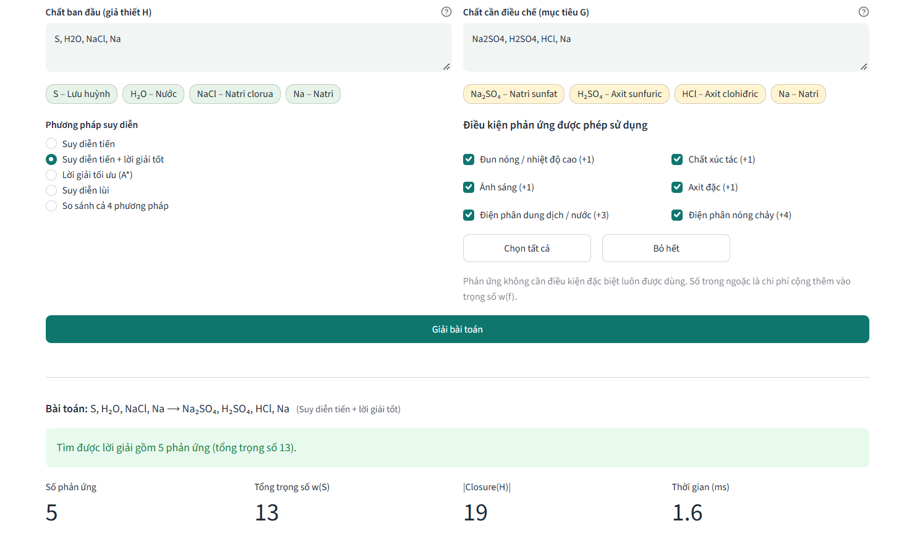

### 3.7. Dữ kiện thiếu hoặc không hợp lệ

Hệ thống kiểm tra dữ kiện trước khi suy diễn:

- **Thiếu dữ kiện:** để trống ô giả thiết hoặc ô mục tiêu → báo thiếu dữ kiện.
- **Chất chưa có trong CSTT:** ví dụ `H2SO` đúng cú pháp công thức nhưng không có trong CSTT → báo lỗi và gợi ý chất gần đúng (H2SO4, H2S, H2O).
- **Công thức sai:** ví dụ `XyZ` chứa ký hiệu nguyên tố không tồn tại → báo lỗi.
- **Dữ kiện trùng:** tự bỏ và có ghi chú.

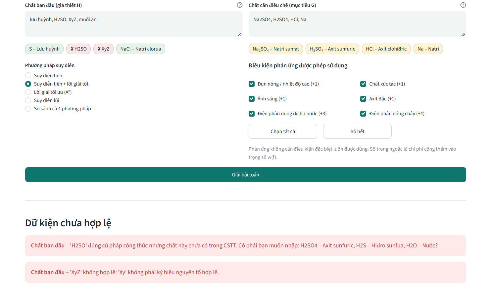

---

## 4. Quản lý cơ sở tri thức

### 4.1. Xem chất hóa học (M)

Tab **Cơ sở tri thức → Chất hóa học (M)**:

- Bảng 82 chất gồm công thức, tên, loại, trạng thái, màu, độ tan, nguyên tử khối, **khối lượng mol** (tính tự động) và số phản ứng có chất đó.
- Có thể lọc theo loại chất hoặc tìm theo tên/công thức.
- Ô **Xem Frame của chất** hiển thị bản ghi JSON đúng như lưu trong file.

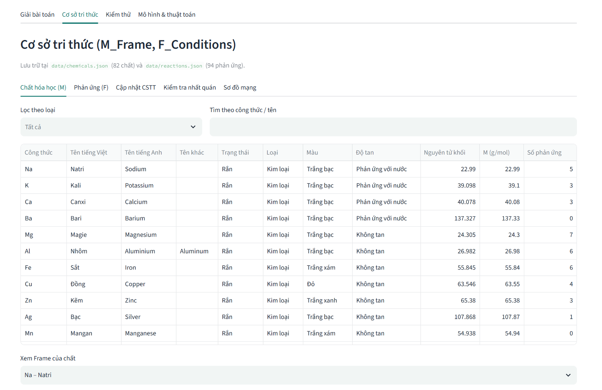

### 4.2. Xem phản ứng (F)

- Bảng 94 phản ứng.
- Có thể lọc theo nhóm, theo điều kiện, hoặc theo một chất có trong phản ứng.
- Có thể xem bản ghi JSON của từng phản ứng.

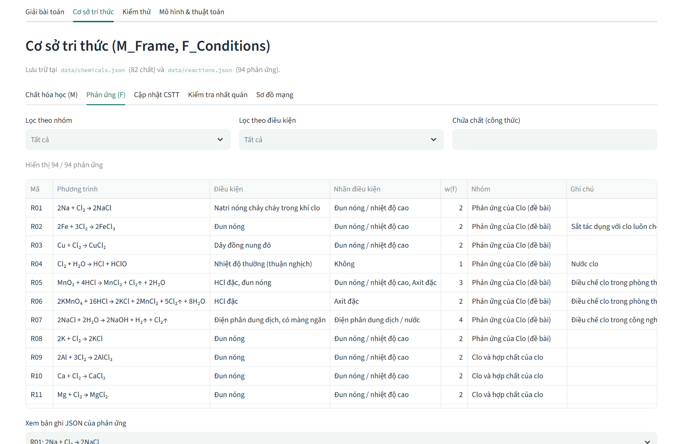

### 4.3. Thêm / sửa / xóa

Vào tab **Cập nhật CSTT** và chọn đối tượng là **Phản ứng** hoặc **Chất hóa học**.

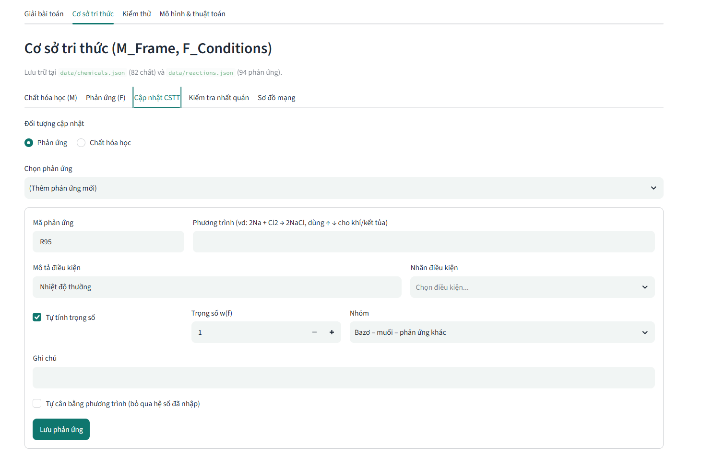

**Thêm phản ứng:**

1. Chọn *(Thêm phản ứng mới)*.
2. Nhập phương trình, ví dụ `Zn + Cl2 -> ZnCl2`. Thêm ký hiệu `↑` hoặc `↓` sau chất khí hoặc chất kết tủa nếu cần.
3. Nếu không ghi hệ số, hoặc đánh dấu **Tự cân bằng**, hệ thống tự tính hệ số cân bằng.
4. Chọn nhãn điều kiện. Trọng số được tự tính nếu đánh dấu **Tự tính trọng số**.
5. Bấm **Lưu phản ứng**.

Trước khi lưu, hệ thống kiểm tra:

- Chất trong phản ứng đã có trong CSTT chưa.
- Phương trình có cân bằng nguyên tố không.
- Mã phản ứng có bị trùng không.
- Phản ứng có trùng với phản ứng đã có không.

Nếu có lỗi, hệ thống báo lỗi và **không lưu**.

**Sửa phản ứng:** chọn phản ứng trong danh sách, chỉnh sửa rồi bấm Lưu.

**Xóa phản ứng:** chọn phản ứng rồi bấm **Xóa**.

**Chất hóa học** được quản lý tương tự. Không xóa được chất đang được dùng trong phản ứng.

**Lưu ý:**

- Mọi thay đổi được ghi ngay vào `data/chemicals.json` và `data/reactions.json`.
- Mục **Khôi phục CSTT gốc** đưa CSTT về đúng bản ban đầu (82 chất, 94 phản ứng).

### 4.4. Kiểm tra tính nhất quán

Bấm **Chạy kiểm tra tính nhất quán**. Kết quả chia thành ba mức: **Lỗi**, **Cảnh báo**, **Thông tin**.

| Kiểm tra | Ý nghĩa |
|---|---|
| Chất chưa khai báo | Phản ứng dùng chất không có trong tập M |
| Chưa cân bằng | Số nguyên tử mỗi nguyên tố ở hai vế khác nhau |
| Rút gọn vế phải | Một chất xuất hiện ở cả hai vế |
| Luật trùng | Hai phản ứng giống hệt nhau |
| Luật thừa (về logic) | Sản phẩm suy được từ các phản ứng khác. Vẫn giữ lại vì đây là một cách điều chế khác |
| Vòng lặp | Từ sản phẩm có thể điều chế lại chất tham gia. Bộ suy diễn chống lặp vô hạn |
| Chất chưa dùng | Chất không có trong phản ứng nào |

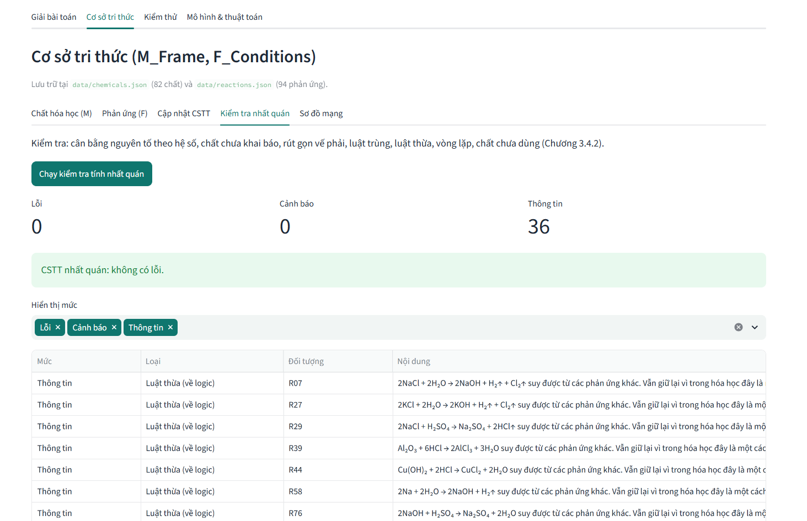

### 4.5. Sơ đồ mạng

Tab **Sơ đồ mạng** vẽ một phần mạng tính toán theo hai cách:

- Theo **một chất**: mọi phản ứng có chất đó.
- Theo **một nhóm phản ứng**.

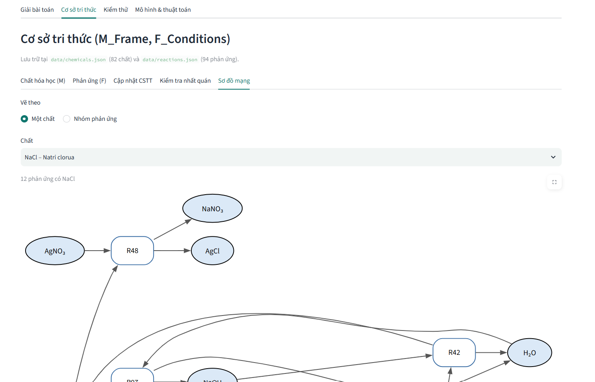

---

## 5. Kiểm thử

Tab **Kiểm thử → Chạy tất cả test case**:

- Chạy 15 test case lưu trong `data/test_cases.json`.
- Bảng tổng hợp cho biết mỗi test case đạt hay không.
- Mở từng test case để xem các mục kiểm tra và lời giải.

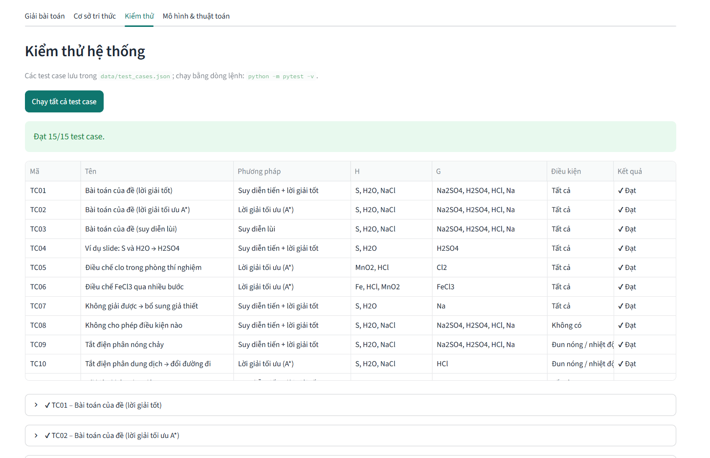

Danh sách test case:

| Mã | Nội dung | Kết quả mong đợi |
|---|---|---|
| TC01 | Bài toán của đề – lời giải tốt | 6 phản ứng, trọng số 18 |
| TC02 | Bài toán của đề – A\* | Trọng số 18, không lớn hơn suy diễn tiến |
| TC03 | Bài toán của đề – suy diễn lùi | Giải được, lời giải hợp lệ |
| TC04 | S, H2O → H2SO4 (ví dụ slide) | R50, R67, R68, R69 |
| TC05 | MnO2, HCl → Cl2 | R05 |
| TC06 | Fe, HCl, MnO2 → FeCl3 | 2 phản ứng, trọng số 5 |
| TC07 | S, H2O → Na | Không giải được, gợi ý bổ sung NaCl |
| TC08 | Tắt mọi điều kiện | Không giải được |
| TC09 | Tắt điện phân nóng chảy | Không điều chế được Na |
| TC10 | Tắt điện phân dung dịch (điều chế HCl) | Đổi đường đi sang R23 + R04 |
| TC11 | Dữ kiện không hợp lệ (H2SO, XyZ) | Báo lỗi dữ kiện |
| TC12 | Thiếu chất cần điều chế | Báo thiếu dữ kiện |
| TC13 | NaCl → NaCl | Lời giải rỗng |
| TC14 | Nhập bằng tên tiếng Việt | Nhận đúng S, H2O, NaCl → H2SO4, NaOH |
| TC15 | Tắt điện phân dung dịch (bài toán của đề) | Không điều chế được H2SO4, Na2SO4 |

Có thể chạy kiểm thử bằng dòng lệnh: `python -m pytest -v`. Lệnh này chạy 30 bài kiểm thử, gồm các test case trên và các kiểm thử đơn vị. Kiểm thử đơn vị có so sánh kết quả A\* với tìm kiếm vét cạn để xác nhận A\* cho lời giải tối ưu.

